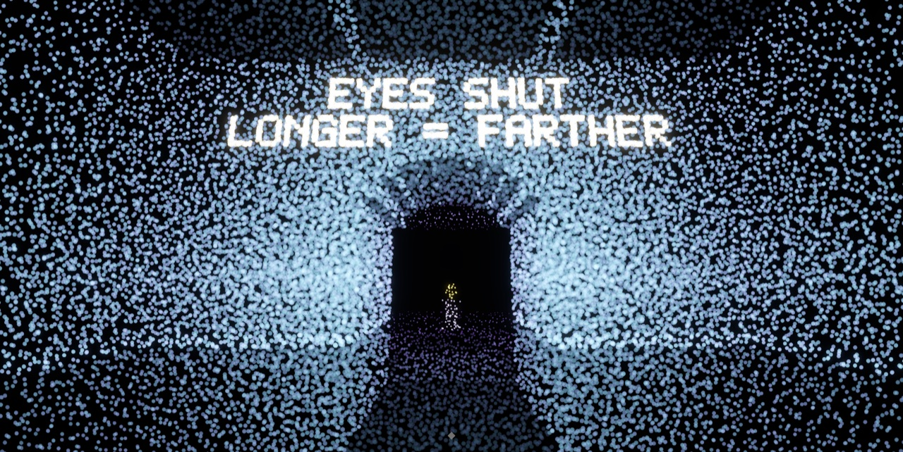
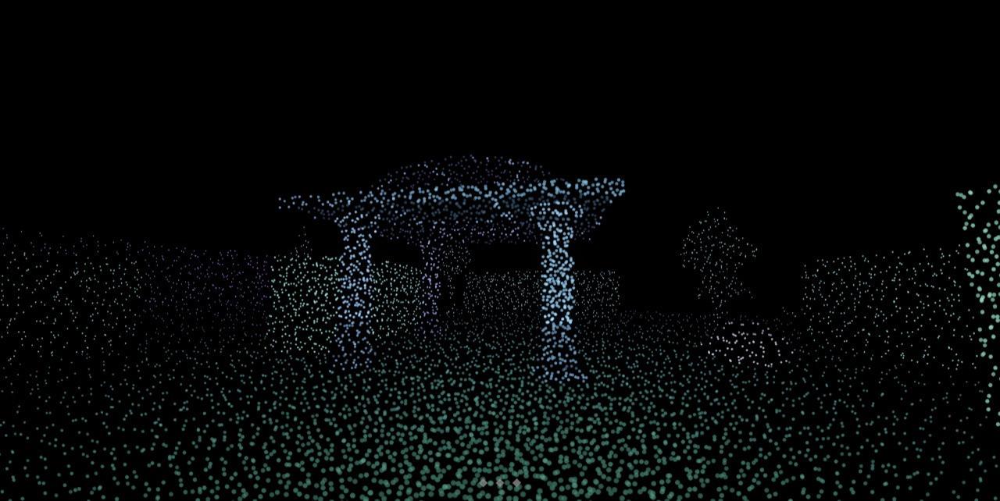
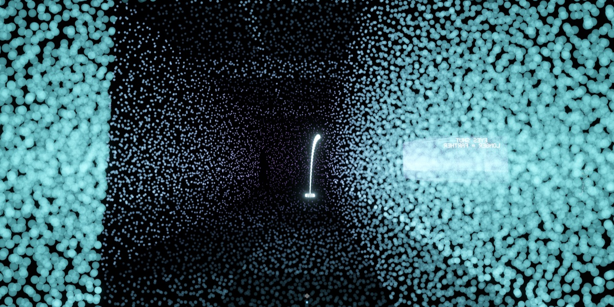

# HotB2026 — BCI w neurorehabilitacji, rozrywce i sztuce

Projekt hackathonowy z wykorzystaniem **g.tec Unicorn Hybrid Black** — 8-kanałowego, bezprzewodowego systemu EEG do rozwoju BCI.

## Wyzwanie

Zamieńcie aktywność mózgu w znaczącą interakcję. Stwórzcie coś, co pomaga ludziom wracać do zdrowia, grać, komunikować się, tworzyć — albo doświadczać technologii w zupełnie nowy sposób.

Możliwe kierunki:

- ćwiczenia rehabilitacyjne sterowane EEG, neurofeedback
- gry sterowane umysłem
- interaktywne instalacje, muzyka, sztuka wizualna
- doświadczenia VR/AR
- nowe formy interakcji człowiek-komputer

## Stack

- **Sprzęt:** g.tec Unicorn Hybrid Black (8 kanałów EEG)
- **Strumieniowanie danych:** Unicorn → g.Pype → filtrowanie / klasyfikacja → UDP JSON → Unity
- **Integracje:** Python, Unity
- **Paradygmaty BCI:** P300, analiza widmowa sygnału

## Zespół

<!-- 3–4 osoby -->

## Gra: Ogród dźwięków

Spokojna gra 2D do treningu słuchowego. Każda roślina to instrument z własnym motywem. Gracz poznaje motyw, potem rozpoznaje go wśród podobnych sekwencji; po trzech trafieniach roślina rośnie i jej głos dołącza do wspólnej kompozycji.

Rola EEG:

| Sygnał | W grze |
|---|---|
| P300 (`select`) | odpowiedź "to ten motyw" w zadaniu typu auditory oddball |
| Motor imagery (`left` / `right`) | nastrój ogrodu: chłodny i molowy albo ciepły i durowy |
| Skupienie (`focus`) | neurofeedback: liczba świetlików i jasność roślin |

Dopóki klasyfikatory nie są skalibrowane, te same zdarzenia daje klawiatura. Gra wysyła znaczniki bodźców do `bci/`, żeby nagrania z rozgrywki posłużyły do kalibracji.

**Uruchomienie:** otwórz `unity/` w Unity 6000.6.9f1 i wciśnij Play w `Assets/Scenes/SampleScene`. Cała scena, grafika i dźwięk powstają z kodu.

| Klawisz | Działanie |
|---|---|
| klik w roślinę / 1–4 | zacznij lekcję tej rośliny |
| Spacja | symulacja P300: start rozpoznawania, "to ten motyw" |
| ← / → | symulacja motor imagery: nastrój |
| ↑ / ↓ | symulacja skupienia |
| R | powtórz motyw |
| prawy przycisk myszy | wycisz / włącz roślinę |
| Esc | przerwa, powrót do ogrodu |

Trudność rośnie z poziomem rośliny, po jednej zmianie naraz: sekwencje wyraźnie inne → różnica jednej nuty → zamieniona kolejność nut i inna barwa.

**Muzyka:** każda roślina ma motyw zapisany w `unity/Assets/Resources/music_bank.json` (stopnie skali; 4 takty, 4/4, 80 BPM). `PhraseComposer` układa z niego pulę fraz dla każdego poziomu rośliny: motyw wprost, w odwróceniu, od końca i z nutami przejściowymi, przeniesiony na kolejne akordy i zagrany w rytmie właściwym dla instrumentu (bas na „raz” i na „i” trzeciej miary, struna ósemkami z pauzami, dzwonek rzadko i synkopami, flet długimi nutami z ozdobnikami). Nuty mają akcenty i drobny rozrzut w czasie. Ogród gra frazę po frazie według formy A A B A C A D E, a rośliny wchodzą w nią z przesunięciem. Do puli trafiają też frazy wpisane w banku (`phrases`), czyli miejsce na materiał z LLM. Każda fraza przechodzi walidację (`MusicValidator`); dźwięk syntezuje `Synth`.

**Obraz:** pixel art 320×180 powiększany bez wygładzania. Wszystko rysuje kod (`PixelArt`): cztery gatunki roślin w czterech stadiach wzrostu (dzwonki, trzciny, wierzba, grzyby), drzewa tła, wzgórza, trawa. Scena chodzi według zegara muzyki: szader `PixelSprite` kołysze koronami, trzcinami i trawą w rytm uderzeń, świecące części roślin pulsują, każda roślina podskakuje na własne nuty, a szader `PixelSky` rysuje gwiazdy migające w rytm, księżyc i zorzę, która jaśnieje, gdy gra więcej roślin, i przyjmuje kolor nastroju.

**Kod** (`unity/Assets/Scripts/`): `Brain/` to warstwa wejścia (zdarzenia `BrainInput`, symulator klawiatury, odbiornik UDP, znaczniki), `Music/` to bank, kompozytor fraz, walidator i syntezator, `Garden/` to rozgrywka i grafika. Szadery są w `unity/Assets/Resources/Shaders/`.

## Druga gra: Mistrzostwa w krojeniu precla na pół (`precel/`)

Osobny projekt Unity (3D, URP). Namiot piwny, deska, precel i nóż. Ruch ręki przesuwa nóż w lewo i w prawo, zaciśnięcie szczęki opuszcza go na precla. Połówki lądują na wadze szalkowej; wygrywa najmniejsza różnica masy. Zawody to pięć precli, po 25 s na każdy.

**Uruchomienie:** otwórz `precel/` w Unity 6000.6.9f1 i wciśnij Play w `Assets/Scenes/SampleScene`. Scena, precle, tekstury i dźwięk powstają z kodu.

| Klawisz | Udaje sygnał | Działanie |
|---|---|---|
| ← / → (albo A / D) | `laterality` | nóż w lewo i w prawo |
| Spacja (trzymaj ok. 0,8 s) | `jaw` | cięcie; puszczona wcześniej cofa nóż |

**Sygnały:** gra nie zna EEG. Korzysta ze wspólnej warstwy `shared/bci-signals` (opis niżej); `Resources/signals.json` wiąże czynności `steer` i `cut` z sygnałami `laterality` i `jaw_active` (zastępczo `jaw`, gdy potok działa bez profilu kalibracji). Panel w rogu ekranu pokazuje wszystkie docierające sygnały na żywo.

**Masa:** precel to zamknięta siatka (rura o zmiennej grubości po krzywej). `MeshSlicer` tnie ją płaszczyzną noża, zamyka przekroje denkami i liczy objętość każdej części z sumy czworościanów ze znakiem. Masa to objętość razy gęstość, więc nie zależy od liczby trójkątów. Każdy precel ma inny kształt, grubość i obrót, więc połowa masy nie leży w połowie szerokości.

**Pod EEG:** cięcie bierze pozycję noża sprzed 0,4 s, bo zaciśnięcie szczęki zakłóca sygnał sterujący. Nóż ma bezwładność, która wygładza szum.

## Trzecia gra: Mrok (`mrok/`)

Osobny projekt Unity (3D, URP). Skradanka z pierwszej osoby w zupełnej ciemności: nic nie ma wyglądu, widać tylko chmurę punktów zostawioną przez skan. Zamknięte oczy ładują skan; po otwarciu fala punktów odsłania stopklatkę otoczenia sięgającą tym dalej, im dłużej oczy były zamknięte (od 4 m po 0,5 s do 28 m po 6 s). Strażnicy na stopklatce zostają tam, gdzie byli, a naprawdę idą dalej. Trzeba zebrać łup i dojść do zielonych drzwi. Gra jest po angielsku.

| | |
|---|---|
|  |  |
| Sala wyboru poziomu: skanuje się sama, poziom wybiera się, podchodząc do drzwi | Samouczek: wskazówki to napisy z punktów, które odsłania skan |
|  |  |
| Muzeum: rotunda z posągami i łupem na postumencie | Ogród: altana, żywopłoty i drzewa pod gołym niebem |
|  | |
| Rzut kamieniem: łuk pokazuje tor, krążek miejsce upadku | |

**Sterowanie z opaski**

| Sygnał | Działanie |
|---|---|
| zamknięte oczy (`eyes_closed_active`) | ładowanie skanu; otwarcie oczu go wypuszcza |
| zaciśnięta szczęka (`jaw_active`) | sprint, zero-jedynkowo: wystarczy lekkie zaciśnięcie. Bieg jest szybki i głośny |

Potok liczy szczękę także bez jej kalibracji (heurystyka względem spoczynku), więc sprint działa z każdym profilem. Powiązania są w `mrok/Assets/Resources/signals.json`, warstwa sygnałów to wspólny pakiet `shared/bci-signals`. Oczy wymagają potoku uruchomionego z profilem kalibracji (`bci_pipeline.py --profile ...`, patrz `docs/calibration.md`).

**Zasady**

- **Strażnicy nie widzą, ale słyszą:** kroki (bieg z 10 m, chód z 6 m, skradanie z 3 m) oraz skan, tym dalej, im większy (55% jego zasięgu). Mur tłumi hałas. Idą w to miejsce, nasłuchują i wracają na trasę. Złapanie to dotknięcie.
- Wzrok strażników (stożek przed twarzą i pogoń) jest w kodzie, ale wyłączony, bo gra była z nim za trudna: `Guard.Sight` w `Guard.cs`.
- **Kamienie** leżą na podłodze (jasnoniebieskie). Podniesione można rzucać: przytrzymany lewy przycisk myszy kołysze siłę rzutu, łuk punktów pokazuje tor i miejsce upadku, puszczenie rzuca. Uderzenie odsłania okolicę jak mały skan (ok. 6 m, tyle co sekunda zamkniętych oczu), a strażnik idzie w to miejsce i dłużej tam nasłuchuje. Wartownik na posterunku schodzi z niego tylko za kamieniem.
- **Kroki strażników** słyszane z bliska zostawiają na podłodze gasnące pomarańczowe ślady (czerwone, gdy strażnik jest zaalarmowany).
- Z zamkniętymi oczami można chodzić. Orientację daje wtedy dźwięk przestrzenny: kroki strażników, dzwonienie łupu i tyknięcia odliczające sekundy ładowania.

**Poziomy** (`Levels.cs`: mapa znakowa, sale, patrole, posterunki, napisy)

- **Tutorial:** sześć sal uczących po kolei skanu, łupu, skradania i rzutu kamieniem. Ostatniego wartownika nie da się minąć bez odciągnięcia go kamieniem.
- **Museum:** hol, galeria z kolumnadą pod sklepieniem kolebkowym, rotunda z posągami pod kopułą, korytarz, biblioteka, dziedziniec z fontanną, magazyn ze skarbcem. Trzy łupy, czterech strażników.
- **Garden:** labirynt żywopłotów, drzewa, głazy, altana z kopułą. Trzy łupy, czterech strażników.

W czasie rozgrywki nie ma napisów. Tekst jest tylko na ekranie ładowania i po zakończeniu poziomu; łup pokazują romby u dołu ekranu, kamienie w kieszeni kropki pod nimi.

**Budowa.** Cały świat to zderzacze budowane z mapy przez `Level.cs` (bryły w `Shapes.cs`, sylwetki ze stawami w `Figure.cs`, napisy i kamienie z punktów w `Sign.cs`). Chmurę punktów rysuje `PointCloud.cs` z shaderem `PointCloud.shader`; kolor punktu zależy od rodzaju powierzchni. Skan to 54 000 promieni liczonych na wątkach roboczych (ok. 40 ms).

**Uruchomienie:** otwórz `mrok/` w Unity 6000.6.9f1 i wciśnij Play w `Assets/Scenes/SampleScene`. Najlepiej w słuchawkach.

| Klawisz | Działanie |
|---|---|
| WASD, mysz (po kliknięciu w okno) albo Q / E | ruch, obrót |
| Shift | skradanie |
| lewy przycisk myszy (trzymaj i puść) | rzut kamieniem |
| Spacja (trzymaj) | „mam zamknięte oczy”: zawsze zapisuje prawdę do nagrania (`truth_closed` / `truth_open`); w trybie KEY albo bez potoku BCI steruje też grą |
| F (trzymaj) | „zaciskam szczękę”: zawsze zapisuje prawdę do nagrania (`truth_jaw_on` / `truth_jaw_off`); w trybie KEY albo bez potoku BCI włącza też sprint |
| F2 | tryb KEY (steruje klawiatura, EEG tylko się nagrywa) / EEG (steruje opaska) |
| F1 | napisy diagnostyczne (sygnały, tryb, klatki/s), domyślnie ukryte |
| Esc | powrót do sali z drzwiami |
| 1 / 2 / 3 | w sali z drzwiami: od razu otwiera poziom |
| R | ponowienie po wpadce (albo zamknięcie oczu na 1,5 s) |

Pad: lewa gałka ruch, prawa gałka obrót, **prawy spust (trzymaj i puść) rzut kamieniem**, B albo lewy bumper skradanie, A jak spacja (zamknięte oczy), lewy spust jak F (zaciśnięta szczęka), Start ponowienie, Select powrót do sali z drzwiami.

## Wspólna warstwa sygnałów (`shared/bci-signals`)

Lokalny pakiet Unity używany przez `precel/` i `mrok/` (wpis `com.hotb.bci-signals` w `Packages/manifest.json`). Nową grę podłącza się tym samym wpisem i własnym plikiem `Resources/signals.json`.

- `SignalHub`: tablica nazwanych sygnałów (nazwa, liczba, źródło). Gra nie wie, skąd pochodzą.
- `UdpSignalSource`: wpisuje do tablicy wszystko, co nadaje potok g.Pype (`bci/bci_pipeline.py`), bez listy znanych nazw.
- `KeyboardSignalSource`: udaje te same sygnały klawiszami.
- `SignalBindings`: wiąże czynność gry z sygnałem i ustawia wzmocnienie, martwą strefę, wygładzanie i próg. Respektuje flagi `<sygnał>_valid` z potoku: sygnał oznaczony jako nieważny liczy się jak brak sygnału. Pole `fallback` wskazuje sygnał zastępczy.
- `MarkerSender`: znaczniki zdarzeń gry odsyłane do potoku.

Ogród dźwięków (`unity/`) ma starszą, własną warstwę (`Brain/`) opartą na komendach `select` / `left` / `right`, które potok nadal nadaje.

## Struktura

| Folder | Zawartość |
|---|---|
| `bci/` | Python: potok g.Pype (Unicorn, filtry, klasyfikator, nadajnik UDP JSON), kalibrator, profile |
| `unity/` | projekt Unity z grą Ogród dźwięków |
| `precel/` | projekt Unity z grą Mistrzostwa w krojeniu precla na pół |
| `mrok/` | projekt Unity z grą Mrok |
| `shared/bci-signals/` | pakiet Unity: warstwa sygnałów wspólna dla gier |
| `docs/protocol.md` | kontrakt między `bci/` a grą: potok, porty, format wiadomości |
| `docs/calibration.md` | obsługa kalibratora, profile, uruchomienie potoku i testy |
| `docs/recording.md` | nagrywanie sesji, tryby Mroka, ocena detektorów oczu i szczęki (`evaluate.py`) |
| `data/` | nagrania EEG (`data/raw/` nie trafia do repo) |

## Uruchomienie

### Python (`bci/`)

Python 3.10 lub nowszy. Jedno środowisko dla potoku i kalibratora:

```
cd bci
python -m venv .venv
source .venv/bin/activate        # Windows: .venv\Scripts\activate
pip install -r requirements.txt
```

`requirements.txt` instaluje g.Pype z oknami (`gui`) i sterownikiem Unicorna (`devices`). Opaskę trzeba wcześniej sparować z komputerem przez Bluetooth.

### Potok BCI (`bci/bci_pipeline.py`)

```text
Unicorn → g.Pype → filtrowanie / klasyfikacja → UDP JSON → Unity
```

Cały tor działa w jednym procesie g.Pype: `HybridBlack → Highpass 1 Hz → Bandstop 48–52 Hz → SignalClassifier → UdpJsonSender`. Węzły są w `bci/gpype_nodes.py`. Nie ma pośredniego LSL ani surowego UDP.

```sh
python bci/calibrate.py                                              # kalibracja, zapisuje profil
python bci/bci_pipeline.py --profile data/calibration/participant.json   # gra z profilem
python bci/bci_pipeline.py                                           # bez profilu: nieskalibrowane heurystyki
python bci/bci_pipeline.py --host <IP komputera z grą>
```

- **Z profilem** potok wysyła `eyes_closed`, `right_hand`, `left_hand`, `jaw` z flagami `_active` i `_valid`, `laterality`, `focus` oraz komendy `left` / `right` dla ogrodu. Brakująca lub nieudana kalibracja daje neutralne zero z `valid=0`.
- **Bez profilu** wysyła heurystyki `focus`, `laterality` i `jaw` liczone względem ostatniej minuty. Wystarczą do ogrodu i precla; Mrok wymaga profilu z kalibracją oczu.
- Okno g.Pype pokazuje EEG po filtrach i sygnały idące do gry. `--no-gui` je wyłącza (na macOS sterownik Unicorna potrzebuje pętli zdarzeń okna, więc tam zostawcie okno).
- Znaczniki gier z portu 5006 zapisują się do `data/raw/bci_markers_*.jsonl`.
- Każda sesja nagrywa się do `data/raw/<sesja>_<czas>/`: surowe i przefiltrowane EEG, znaczniki gry na próbkach EEG i wyjście detektora (`--session mrok_s01`, `--no-record` wyłącza). Kalibrator nagrywa się tak samo. Ocena: `python bci/evaluate_eyes.py <folder>`. Pełna instrukcja: [docs/recording.md](docs/recording.md).
- Kilka gier naraz: `--target host:port` (każda gra na własnym porcie).

**Kalibracja:** `bci/calibrate.py` ma cztery widoki: oczy zamknięte, wyobrażanie ruchu prawej dłoni, lewej dłoni oraz szczęka (EMG). Uruchamia w swoim procesie ten sam początek potoku (`HybridBlack → filtry`) i zapisuje wspólny dla wszystkich gier profil JSON. Opaskę trzyma naraz jeden proces: po kalibracji wybierzcie „Rozłącz” albo zamknijcie kalibrator, potem uruchomcie `bci_pipeline.py`. Pełna instrukcja: [docs/calibration.md](docs/calibration.md).

Bez opaski, na syntetycznym EEG (ten sam potok, źródło `SyntheticUnicorn` zamiast `HybridBlack`):

```sh
python bci/calibrate.py --fake                  # profil data/calibration/fake.json
python bci/bci_pipeline.py --fake --allow-simulated --profile data/calibration/fake.json
python bci/bci_pipeline.py --fake               # heurystyki; zadania zmieniają się w 27-sekundowym cyklu
```

### Atrapa sygnału (bez g.Pype)

`bci/mock_sender.py` wysyła do gry fałszywe komendy i metrykę `focus` w formacie z `docs/protocol.md`. Nie wymaga żadnych pakietów (na macOS zamiast `python` może być potrzebne `python3`).

```
python bci/mock_sender.py                # losowe komendy co 2–4 s + płynnie zmieniający się focus
python bci/mock_sender.py --interactive  # wpisujesz np. "left" albo "focus 0.8"
```

### Znaczniki do CSV

```
python bci/marker_logger.py              # opcjonalny CSV; potok uruchomcie wtedy z --no-markers (ten sam port)
```

### Unity (`unity/`)

Cały zespół używa tej samej wersji Unity: 6000.6.9f1 (zapisana w `unity/ProjectSettings/ProjectVersion.txt`).
